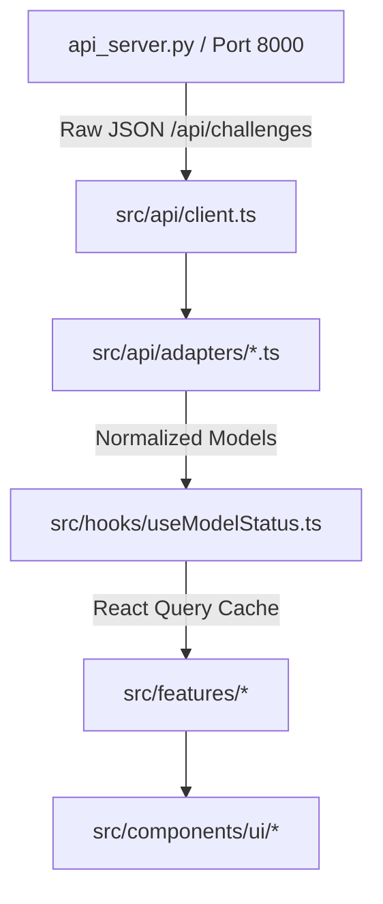

# Architecture Overview

## 1. Directory Structure
See [AGENTS.md](file:///e:/backtest/frontend/AGENTS.md) for full folder map.

## 2. Mermaid Data Flow


## 3. Worked Example: Trade Status & Action Flow
```
User clicks Action
  ➔ UI Event in TradeCard (features/sidebar/TradeCard.tsx)
  ➔ Calls mutation hook (hooks/useTradeActions.ts)
  ➔ API Client POST /api/trade/toggle with payload
  ➔ Backend updates state JSON atomically
  ➔ TanStack Query queryClient.invalidateQueries({ queryKey: ['modelStatus', modelId] })
  ➔ Hook re-renders UI seamlessly without page reload
```

## 4. Imperative Chart Bridge
Lightweight Charts is imperative and canvas-based. The React wrapper:
1. First `useEffect`: Mounts `createChart()` once to a DOM `ref` with `ResizeObserver` and cleanup `chart.remove()`.
2. Second `useEffect`: Calls `series.setData(data)` imperatively when candle data updates without recreating canvas DOM.
