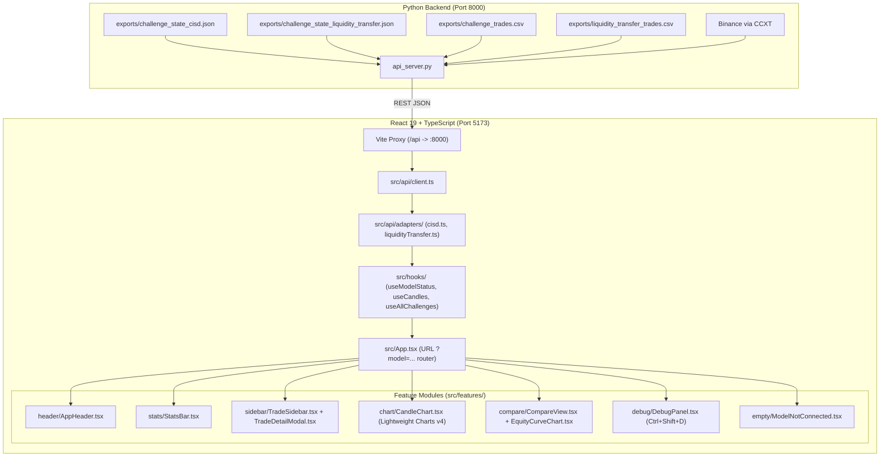

# 🚀 SMC Prop Trading Fleet Dashboard

A production-grade, dual-model trading dashboard built with **React 19 + TypeScript strict**, **Vite**, **Tailwind CSS**, **@tanstack/react-query**, and **TradingView Lightweight Charts v4**.

Designed to monitor and compare autonomous algorithmic models (`CISD Multi-TF` and `Liquidity Transfer`) side-by-side with zero layout shifts, offline resilience, and modular extensible architecture.

---

## ⚡ Quickstart — How to Run

### Option 1: All-in-One Launcher (Windows)
Double-click [`start_all.bat`](file:///e:/backtest/start_all.bat) in the repository root. This opens 4 dedicated terminal windows:
1. **API Server**: `python api_server.py` (Port 8000)
2. **Challenge Fleet**: `python run_challenge_fleet.py` (Runs both models in parallel)
3. **Market Scanner**: `python live_scanner.py` (Scans Binance pairs)
4. **Dashboard**: `cd frontend && npm run dev` (Vite on `http://localhost:5173`)

---

### Option 2: Step-by-Step Manual Run

#### 1. Start the API Server (Backend)
```bash
# In the root repository directory (e:\backtest)
python api_server.py
```
> Serves endpoints at `http://localhost:8000/api/challenges` and `http://localhost:8000/api/live_candles`.

#### 2. Start the Frontend Dashboard
```bash
# In a second terminal
cd frontend
npm run dev
```
> Open your browser to **`http://localhost:5173`**.

#### 3. Run the Trading Bots (Optional)
```bash
# In a third terminal (runs both CISD and Liquidity Transfer bots in parallel)
python run_challenge_fleet.py

# Or run one single scan pass across both:
python run_challenge_fleet.py --once
```

---

## 🧪 Verification & Testing Commands

Inside `frontend/`:
```bash
npm run typecheck   # Typecheck entire codebase with TypeScript strict mode
npm run lint        # Fast zero-warning linting with oxlint
npm run test        # Run all 10 unit & integration tests with Vitest + MSW
npm run build       # Production build (validates chunking, bundle size, and syntax)
```

---

## 🗺️ Codebase & Architecture Guide



---

## 📂 Key Architecture Documents

| File | Purpose |
|---|---|
| [`frontend/ARCHITECTURE.md`](file:///e:/backtest/frontend/ARCHITECTURE.md) | Component tree, data-flow diagrams, and worked execution examples. |
| [`frontend/API_CONTRACT.md`](file:///e:/backtest/frontend/API_CONTRACT.md) | Formal REST request/response contracts for all endpoints. |
| [`frontend/DECISIONS.md`](file:///e:/backtest/frontend/DECISIONS.md) | Architectural Decision Records (ADRs) explaining *why* choices were made. |
| [`frontend/PROJECT_BRIEF.md`](file:///e:/backtest/frontend/PROJECT_BRIEF.md) | High-level goals, scope boundaries, and personas. |
| [`frontend/TASKS.md`](file:///e:/backtest/frontend/TASKS.md) | Roadmap and implementation checklists. |
| [`frontend/TESTING.md`](file:///e:/backtest/frontend/TESTING.md) | Test structure, MSW mock server patterns, and coverage strategy. |
| [`frontend/AGENTS.md`](file:///e:/backtest/frontend/AGENTS.md) | Maintenance directives and conventions for AI and human developers. |

---

## 💡 How to Add Model 3 (Future-Proofing)

Adding a new strategy model requires **no UI rewrites**:
1. **Define strategy in backend**: Add model entry in `core/config.py` under `STRATEGY_INSTANCES`.
2. **Register model in frontend**: Add model metadata in [`src/config/models.ts`](file:///e:/backtest/frontend/src/config/models.ts).
3. **Add adapter**: Create `src/api/adapters/yourModel.ts` to map backend fields to the common `ChallengeStatus` interface.
4. **Done**: Switcher tabs, stats bars, charts, trade cards, and the compare matrix automatically pick it up!
