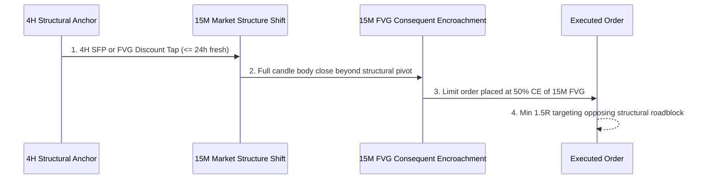

# 🎓 05. System Implementation & Engineering Masterclass
### Complete Technical & Quantitative Trading Curriculum

This masterclass document bridges institutional trading concepts with production software engineering. Every strategy, risk law, mathematical formula, and architectural pattern implemented across the bot fleet and the React dashboard is broken down here for in-depth study.

---

## 📑 Curriculum Overview
1. [Strategy 1: CISD Multi-Timeframe Engine](#1-strategy-1-cisd-multi-timeframe-engine)
2. [Strategy 2: The Liquidity Transfer Model](#2-strategy-2-the-liquidity-transfer-model)
3. [Prop Firm Risk & Capital Preservation Laws](#3-prop-firm-risk--capital-preservation-laws)
4. [Execution Mathematics & Formulae](#4-execution-mathematics--formulae)
5. [Parallel Fleet & System Architecture](#5-parallel-fleet--system-architecture)
6. [Interactive React Dashboard Engineering](#6-interactive-react-dashboard-engineering)
7. [Study & Self-Quiz Checklist](#7-study--self-quiz-checklist)

---

## 1. Strategy 1: CISD Multi-Timeframe Engine

The **CISD (Change in State of Delivery)** strategy is an algorithmic implementation of structural order flow transition across aligned timeframes.

### 🕒 Timeframe Alignment Chains
Markets are fractal. A single timeframe shows noise; three synchronized timeframes reveal institutional delivery:
* **Context (HTF)**: Daily (`1d`) or Weekly (`1w`) — Defines master trend, key Order Blocks (OBs), and premium/discount ranges.
* **Bias (MTF)**: 1-Hour (`1h`) or 4-Hour (`4h`) — Identifies liquidity sweeps and Fair Value Gap (FVG) displacement.
* **Entry (LTF)**: 5-Minute (`5m`) or 15-Minute (`15m`) — Identifies precise zone mitigation, entry triggers, and invalidation points.

### ⚡ Core Rules & Triggers
1. **Displacement Filter**: A valid CISD candle must close with strong expansion. In the code, this is quantified:
   $$\text{Displacement Ratio} = \frac{|\text{Close} - \text{Open}|}{\text{ATR}(14)} \ge 1.2$$
   If the candle body is less than $1.2\times$ average true range, it is skipped as weak noise.
2. **Order Block (OB) Validation**: The last opposing candle before high-volume displacement that broke market structure.
3. **Fair Value Gap (FVG)**: A 3-candle sequence where Candle 1's high does not overlap Candle 3's low (Bullish FVG), leaving an imbalance where price was offered to only one side of the market.
4. **Swing Failure Pattern (SFP)**: Price wicks beyond a prior swing high/low but **closes back inside** the range, indicating liquidity absorption rather than continuation.

---

## 2. Strategy 2: The Liquidity Transfer Model

The **Liquidity Transfer Model** is designed for high win-rate swing and intraday setups based on higher-timeframe structural taps.



### 3 Sequential Phases:
1. **Phase 1 — 4H Structural Anchor**:
   - Price must tap a 4H FVG in discount (for longs) or premium (for shorts), or execute a 4H SFP.
   - **Bias Expiry Rule**: The 4H anchor has a strict $24\text{-hour}$ maximum shelf-life. If structure does not shift within 24 hours, the setup is invalidated.
2. **Phase 2 — 15M Market Structure Shift (MSS)**:
   - A wick break is NOT sufficient. The 15M candle must print a **full body close** beyond the prior swing high/low.
3. **Phase 3 — 15M Retest Entry (Consequent Encroachment)**:
   - Rather than market entering at the breakout, an entry order waits at the **Consequent Encroachment (50% midpoint)** of the displacement FVG:
     $$\text{Entry Price} = \frac{\text{FVG High} + \text{FVG Low}}{2}$$
   - This provides superior risk-to-reward ($R:R$) and minimizes stop-out rate.

---

## 3. Prop Firm Risk & Capital Preservation Laws

The code implements prop firm challenge rules directly in `core/config.py` and `challenge_trader.py`:

```
┌────────────────────────────────────────────────────────┐
│               $5,500 (+10% Profit Target)              │
│                           ▲                            │
│                           │  Progression               │
│               $5,000 (Starting Balance)                │
│                           │                            │
│                           ▼  Drawdown                  │
│               $4,700 (-6% Max Drawdown Floor)          │
│               $4,600 (-8% Max Weekly Loss Limit)       │
└────────────────────────────────────────────────────────┘
```

1. **Fixed Risk per Trade**: Exactly $\$35.00$ to $\$50.00$ ($0.7\% - 1.0\%$ of starting capital).
2. **Trailing Max Drawdown**: Balance must never dip below $\$4,700.00$ (6% of peak equity). If breached, `status = "HALTED"`.
3. **Weekly Circuit Breaker**: If weekly open balance drops by more than $8\%$ ($\$4,600.00$), trading pauses until the next weekly session.
4. **Daily Trade Cap**: Maximum 3 closed/open trades per calendar day to prevent revenge trading or overtrading during chop regimes.
5. **Position Concurrency Limit**: Maximum 4 open trades at any time.

---

## 4. Execution Mathematics & Formulae

These formulas are unit-tested in `frontend/src/lib/math.ts`:

### A. R-Multiple & PnL Calculation
$$R = \frac{\text{Exit Price} - \text{Entry Price}}{|\text{Entry Price} - \text{SL Price}|}$$
$$\text{PnL (USD)} = R \times \text{Risk USD}$$

### B. Dynamic Position Management Rules
* **Break-Even (BE) Trigger at 1.5R**:
  When price reaches $1.5R$, the stop loss is automatically moved to $\text{Entry Price} + \text{Slippage Buffer}$. The trade is now risk-free ($0.0R$ worst-case).
* **Partial Take Profit at 2.0R**:
  When price hits $2.0R$, $50\%$ of the position is closed immediately, banking $\$35.00$ to $\$50.00$ in cash.
* **Trailing Stop Loss**:
  On the remaining $50\%$, trailing activates behind swing pivots to capture runner trends up to $3R - 5R$.

### C. Win Rate & Mathematical Expectancy
$$\text{Win Rate (WR)} = \frac{\text{Wins}}{\text{Total Closed Trades}} \times 100$$
$$\text{Expectancy } (E) = (\text{Win Rate} \times \text{Average Win}) - (\text{Loss Rate} \times \text{Average Loss})$$
Even with a $40\%$ win rate, because the system enforces a $2:1$ Reward-to-Risk ratio, the math remains positively expected:
$$E = (0.40 \times 2.0R) - (0.60 \times 1.0R) = 0.8R - 0.6R = +0.2R \text{ per trade}$$

---

## 5. Parallel Fleet & System Architecture

### 🔄 Multi-Process Supervisor (`run_challenge_fleet.py`)
* Uses Python's `subprocess.Popen` with non-blocking threads to stream stdout tags (`[CISD]` vs. `[LIQUIDITY]`).
* Handles `SIGINT` (Ctrl+C) with graceful shutdown across child processes.

### 🛡️ Atomic State Persistence (`challenge_trader.py`)
To prevent corrupting state JSON files if a power failure occurs during write:
```python
tmp_file = STATE_FILE + ".tmp"
with open(tmp_file, "w") as f:
    json.dump(state, f, indent=2)
os.replace(tmp_file, STATE_FILE)  # Atomic OS-level swap
```

### 🌐 Zero-Dependency REST API (`api_server.py`)
* Built with Python's standard `http.server` — runs anywhere without pip dependency conflicts.
* Implements in-memory TTL caching (10 seconds) on exchange queries to prevent Binance IP rate-limiting.

---

## 6. Interactive React Dashboard Engineering

The frontend adheres to strict institutional software engineering standards:

1. **Lightweight Charts v4 Canvas Lifecycle**:
   - Canvas charts cannot be re-rendered on every React state change.
   - Uses two decoupled `useEffect` hooks:
     - **Hook 1**: Mounts `createChart()` once to DOM ref with `ResizeObserver` and disposes on unmount.
     - **Hook 2**: Pushes candle arrays imperatively via `series.setData(sortedCandles)` without DOM destruction.
2. **Schema Adapter Pattern** (`src/api/adapters/`):
   - CISD backend uses `snake_case` (`trade_id`, `pnl_usd`).
   - Liquidity Transfer uses historical `PascalCase` (`Timestamp`, `Entry`, `Exit Price`).
   - Adapters normalize both into a single strongly-typed TypeScript domain contract (`ChallengeStatus`).
3. **Resilient Non-Blocking UX**:
   - The top navigation bar and model switcher are never removed from the DOM during query errors. If model 2 is offline, model 1 remains interactive.
4. **Dev Diagnostics HUD**:
   - Embedded debugging panel gated with `import.meta.env.DEV` (dead-code stripped in production builds). Press `Ctrl + Shift + D` to inspect query latencies and raw payloads.

---

## 7. Study & Self-Quiz Checklist

Use this checklist to test your comprehension of the codebase:

- [ ] Can you explain why the entry in the Liquidity Transfer model waits for 50% Consequent Encroachment instead of market entering at the breakout?
- [ ] Why does `api_server.py` use an in-memory TTL cache on `/api/live_candles`?
- [ ] What is the difference between a market structure shift (MSS) and a swing failure pattern (SFP)?
- [ ] How does `buildEquityCurve()` in `frontend/src/lib/math.ts` handle open positions vs. closed positions?
- [ ] What CLI command resets both challenge models back to a clean $\$5,000.00$ balance? (`python run_challenge_fleet.py --reset`)
- [ ] If you want to add a third strategy (e.g. `macro_breakout`), which 2 files must be touched? (`core/config.py` and `frontend/src/config/models.ts`).
