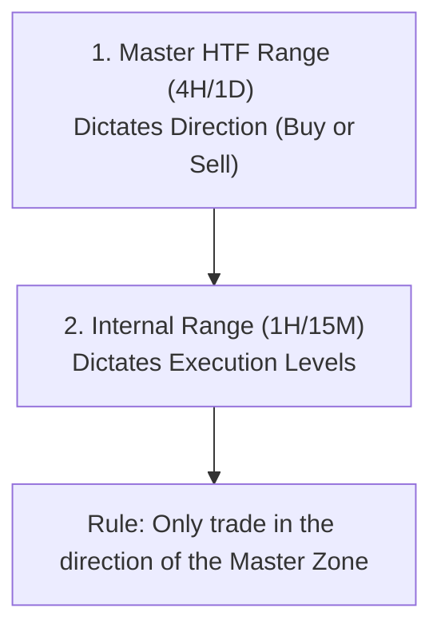

# 🗺️ Overlapping Ranges & Sweep Exhaustion Playbook

This playbook defines the strict rules for handling multiple overlapping ranges (HTF, Local, and Internal) and how to execute safely when the market wicks multiple times (Sweep Exhaustion) before reversing.

---

## Part 1: The Hierarchy of Ranges (Overlapping Ranges)

When you have multiple ranges drawn on your chart, you must establish a clear hierarchy to avoid analysis paralysis:



### The Three Rules of Hierarchy:
1.  **The Master Range Rules:** Identify the absolute outer boundaries of the current 4H structure (e.g., $58,045.4 - $65,633.2). Draw the 0.5 Equilibrium. This Master Range determines your directional bias:
    *   **Master Premium (> 0.5):** You are strictly looking for **Shorts only**.
    *   **Master Discount (< 0.5):** You are strictly looking for **Longs only**.
2.  **The Internal Range Subordination:** If you draw a smaller range inside the Master Range (e.g., $62,508.6 - $65,391.6):
    *   You **only** trade setups at the boundaries of the internal range that align with the Master Range bias.
    *   *Example:* If the internal range is in the Master Premium zone, you **only** short the Internal Range High ($65,391.6). You **do not** long the Internal Range Low, because buying the internal low means buying in the Master Premium (high risk).
3.  **Clean the Chart:** Once a local range is broken by a candle body close (BOS), delete it immediately. Keep only the active Master HTF Range and the current active Internal Range.

---

## Part 2: The Multiple Sweep Trap (Sweep Exhaustion)

At major range highs/supply blocks, the market will often wick above the level multiple times (printing minor SFPs) to collect buy-stop liquidity before the actual drop. If you enter too early, you get stopped out repeatedly.

### How to Execute Safely:

```
[Wick Sweep 1] ➔ [Wick Sweep 2 (Higher)] ➔ [Bearish CHoCH Close] ➔ [Retest Entry]
```

1.  **Use a True HTF Stop Loss:** Never place your stop loss tightly above the first local wick sweep. Your stop loss must remain anchored to the **Master Range invalidation level** (above $65,391.6 or $65,633.2 + buffer). 
2.  **Wait for the Bearish CHoCH (Structure Close):** Do not blind-enter on the first wick touch. 
    *   Wait for the price to wick above the level.
    *   Zoom in to the 15M/5M.
    *   Wait for a candle body to close below the last local swing low (Bearish CHoCH/MSB). 
    *   If the price keeps wicking but never closes below the local low, it is still building liquidity. **Do not enter.**
3.  **The Max 2 Attempts Rule:** If you get a valid SFP trigger and enter, but the market wicks higher and stops you out:
    *   You are allowed **one re-entry** if a new, higher SFP prints with a new bearish CHoCH.
    *   If you get stopped out a second time, **stop trading that zone.** The market is preparing for a full trend expansion.
